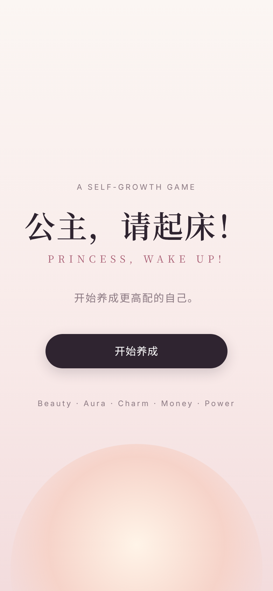
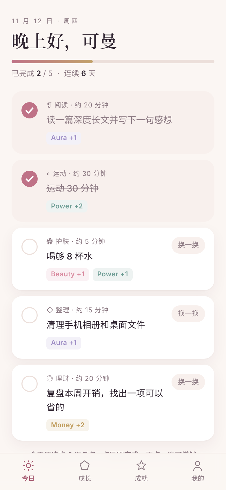
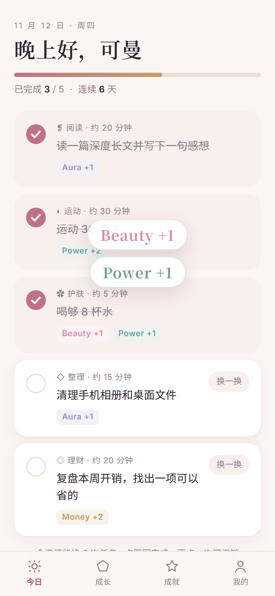
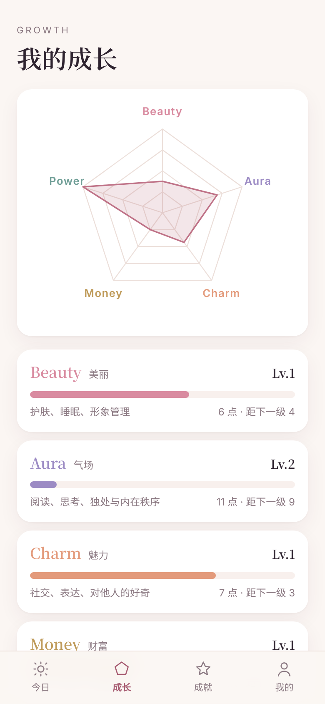

# 公主，请起床！PRINCESS, WAKE UP!

> 开始养成更高配的自己。

一款把**女性自我成长**做成养成游戏的轻量 Web App：每天收到几件小任务，完成后 Beauty、Aura、Charm、Money、Power 五项属性即时成长，连续打卡、解锁成就，看见自己一点点变好。

它不是恋爱或儿童养成游戏，而是 gamified self-improvement：任务都是现实生活里的小事（护肤、运动、阅读、记账、联系朋友），游戏化只负责让坚持更有反馈。

<p>
  
  
  
  
</p>

## 功能

| 页面 | 做什么 |
|---|---|
| 启动页 | “公主，请起床！”日出动画，新用户进入建档，老用户继续养成 |
| 建档页 | 称呼、年龄、身份、每天可投入时间、预算；之后可在「我的」修改 |
| 今日任务 | 按档案生成 3–6 个任务，尽量覆盖不同类别；点击完成、再点撤销；每天可“换一换” 3 次；完成后弹出 `Power +2` 等成长反馈 |
| 成长 | 五项属性的等级与进度条、五边形雷达图、最近 7 天完成数 |
| 成就 | 11 个成就（First Step、7-Day Starter、Beauty Builder、Power Up、Money Minded……），未解锁的显示进度 |
| 我的 | 养成天数、累计完成、最长连续、完美的一天、档案修改、清空数据 |

数据只保存在浏览器 localStorage 里，不需要账号，也不会上传。

## 运行

需要 Node.js 18 或以上。

```bash
npm install
npm run dev      # 本地开发，打开终端里显示的地址
npm test         # 运行游戏逻辑单元测试
npm run build    # 生成 dist/，可直接部署到 GitHub Pages 等静态托管
```

想看有几天数据的效果：`node scripts/make-demo-state.mjs`，把输出的 JSON 存进浏览器 localStorage 的 `princess-wake-up/v1` 键。脚本用的是真实的游戏逻辑，只是模拟了前几天的操作。

## 项目结构

```
src/
├── data/            规则全部写成数据，改这里就能调平衡，不用碰界面
│   ├── attributes.js      五项属性、颜色、每级所需点数
│   ├── tasks.js           32 个任务：类别、耗时、花费、奖励
│   ├── achievements.js    11 个成就及其解锁条件
│   └── profileOptions.js  建档选项、每日任务数、换一换次数
├── logic/           纯函数游戏引擎（不依赖 React / DOM / localStorage）
│   ├── taskEngine.js      按时间和预算筛选任务、生成每日清单、换一换
│   ├── game.js            完成 / 撤销、属性结算、连续天数、完美的一天
│   └── achievements.js    按数据里的条件计算成就与进度
├── state/useGame.js 唯一连接逻辑和 React 的地方：持久化、跨天、反馈队列
├── components/      页面与组件
├── styles/          设计变量、基础样式、组件样式
└── utils/           日期、带种子的随机数、存储、等级计算
tests/               游戏逻辑单元测试（Vitest，15 个用例）
legacy/              v0 原型（2026 年 4 月，纯 HTML/CSS/JS），原样保留
```

## 设计决策

- **规则即数据**：任务奖励写在 `tasks.js` 里（如 `{ power: 2 }`），成就条件写在 `achievements.js` 里（如 `{ type: 'streak', gte: 7 }`）。新增任务或成就只改数据文件。
- **逻辑是纯函数**：`(state, 操作, 今天) → 新 state`，所以能直接写单元测试，也方便以后迁到 React Native、小程序或接后端。
- **每日任务可复现**：随机数以“用户建档日 + 当天日期”为种子，刷新页面不会重新洗牌，换一换也不能无限刷。
- **一天至少碰到不同方面**：生成时先每个类别最多选一个，再补足数量，避免一天全是护肤。
- **反馈不打扰**：成长反馈是浮起的小标签，1.6 秒自动消失；系统设置“减少动态效果”时动画自动关闭。
- **成就节奏**：按每天 4–5 个任务估算，属性类成就约 2–3 周解锁，避免一周内全部拿完。

## 开发过程

| 版本 | 时间 | 内容 |
|---|---|---|
| 产品设计 | v0 前后 | 定下名称、五项属性、页面结构与用户流程 |
| v0 原型 | 2026.04 | 纯 HTML/CSS/JS：选目标 → 每日清单 → 打勾 → 进度条（见 `legacy/`） |
| v1 MVP | 2026.11 | React + Vite 重建：建档、属性成长、成就、连续天数、成长页，数据与逻辑分层，加单元测试 |

本项目为 **AI 辅助开发（AI-assisted product development）**：产品概念、属性体系、页面与流程由作者提出并主导设计；v0 原型和 v1 代码在 AI 编程助手协助下实现，作者负责需求拆解、规则取舍、验收和迭代方向。

## 下一步

- [ ] 可安装的 PWA（离线、添加到主屏幕、每日提醒）
- [ ] 自定义任务（v0 原型里有，v1 暂未迁移）
- [ ] 每周成长报告与分享卡片
- [ ] 账号与云同步（Supabase / Firebase），多设备共享进度
- [ ] 按完成情况动态调整任务难度
